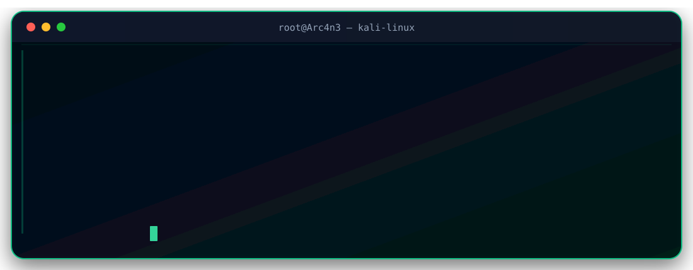
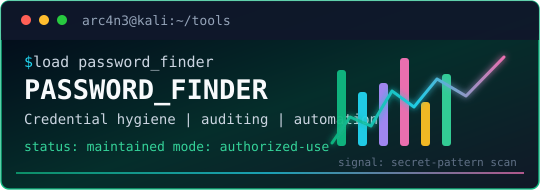
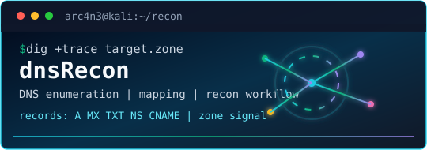
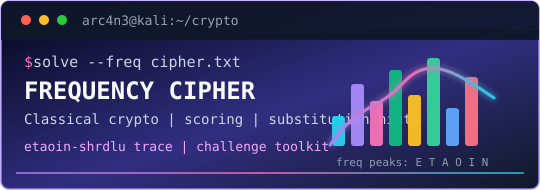
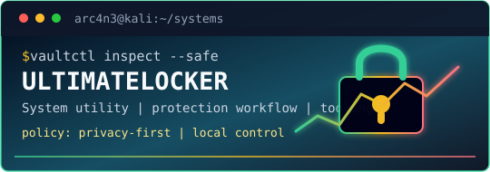
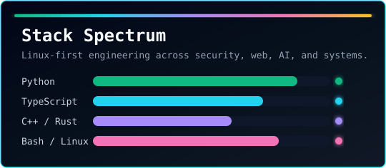

<!-- =========================================================
     GitHub Profile README — Md. Ibrahim Reza Rabbi (Arc4n3)
     Theme: Cyber Engineering / Offensive Security / Dark Emerald
========================================================== -->

<div align="center">

  <!-- HERO -->
  <a href="https://ibrahim-reza.vercel.app">
    
  </a>

  <!-- GITHUB-COMPATIBLE ANIMATED LINUX TERMINAL -->
  <!-- Keep this file at: assets/arc4n3-terminal.svg -->
  <a href="https://ibrahim-reza.vercel.app">
    
  </a>
  
  <p align="center"><i><sub style="color: #10B981;">For the optimal viewing experience, please ensure your GitHub theme is set to Dark Mode.</sub></i></p>

  

  <br><br>

  <!-- PRIMARY LINKS -->
  <!-- REPLACE THE '#' BELOW WITH YOUR ACTUAL RESUME PDF LINK -->
  <a href="#">
    
  </a>
  <a href="https://www.linkedin.com/in/ibrahim-reza-b12427415">
    
  </a>
  <a href="https://scholar.google.com/citations?user=Cl59HS0AAAAJ&hl=en">
    
  </a>
  <a href="https://ibrahim-reza.vercel.app">
    
  </a>
  <a href="https://tryhackme.com/p/Arc4n3">
    
  </a>
  <a href="mailto:ibrareza2020@gmail.com">
    
  </a>

  <br><br>

  <!-- LIVE SIGNALS -->
  
  
  

</div>

<br>

<!-- =========================================================
     INITIALIZATION
========================================================== -->

<div align="center">
  
  <h2><code>root@Arc4n3:~# initialize_profile</code></h2>
</div>

```yaml
operator:
  name: "Md. Ibrahim Reza Rabbi"
  alias: "Arc4n3"
  education: "B.Sc. in Computer Science and Engineering — MIST"
  roles:
    - "Software Engineer"
    - "Offensive Security & CTF Practitioner"
    - "Security Tool Builder"
    - "Applied AI Researcher"

core_capabilities:
  - "Secure software engineering"
  - "CTF problem solving and offensive-security tooling"
  - "Kali Linux reconnaissance, exploitation and analysis workflows"
  - "Web, network, cryptography and digital-forensics challenges"
  - "AI-assisted applications and research prototypes"

verified_signals:
  research: "2 peer-reviewed IEEE publications"
  cybersecurity: "Top 3% globally on TryHackMe"
  innovation: "Top 10 CES Pavilion innovation — BEAR Summit 2026"
  academics: "Dean's Award for Academic Excellence"

mission: >
  Build secure, intelligent and accessible technology that solves
  meaningful real-world problems.
```

<br>

<!-- =========================================================
     ABOUT
========================================================== -->

## 👾 About Me

I am a **Computer Science and Engineering graduate from MIST** working at the intersection of **software engineering, offensive cybersecurity, CTF problem solving, and applied artificial intelligence**.

I build secure web platforms, browser and editor extensions, cybersecurity utilities, cross-platform applications, AI-assisted healthcare solutions, and research-driven prototypes. I am comfortable working in **Kali Linux environments** and using offensive-security tools for reconnaissance, web testing, network analysis, cryptography, reverse engineering, password auditing, and digital forensics in **legal, authorized, and educational environments**.

<table width="100%">
<tr>
<td width="50%" valign="top">

### ⚡ Impact

- 🛡️ **Top 3% globally** on TryHackMe as **Arc4n3**
- 📄 Co-author of **two peer-reviewed IEEE papers**
- 🏆 **Top 10 CES Pavilion** innovation at BEAR Summit 2026
- 🎓 **Dean's Award** for Academic Excellence
- 🧩 Published developer on the Chrome and VS Code stores

</td>
<td width="50%" valign="top">

### 🎯 Engineering Focus

- Offensive Security and CTF Operations
- Secure Full-Stack Software Engineering
- Kali Linux Security Workflows
- Security Automation and Reconnaissance
- Applied AI and Intelligent Systems
- Assistive and Healthcare Technology

</td>
</tr>
</table>

<br>

<!-- =========================================================
     CORE STACK
========================================================== -->

<div align="center">

## ⚔️ Core Engineering Stack


<br>

<a href="https://skillicons.dev">
  
</a>

<br><br>


<br>


</div>

<br>

<!-- =========================================================
     CTF / KALI ARSENAL
========================================================== -->

## 🐉 CTF & Kali Linux Arsenal

> A practical security toolbox for authorized labs, CTF environments, research, and defensive validation.

<table width="100%">
<tr>
<td width="50%" valign="top">

### 🔎 Reconnaissance & Enumeration

<p>
  
  
  
  
  
  
</p>

### 🌐 Web Exploitation & Testing

<p>
  
  
  
  
  
  
</p>

### 🔐 Passwords, Hashes & Cryptography

<p>
  
  
  
  
  
</p>

</td>
<td width="50%" valign="top">

### 💥 Exploitation, AD & Post-Exploitation

<p>
  
  
  
  
  
</p>

### 🧩 Reverse Engineering & Binary Exploitation

<p>
  
  
  
  
  
</p>

### 🧪 Forensics, Steganography & Traffic Analysis

<p>
  
  
  
  
  
  
</p>

</td>
</tr>
</table>

<details>
<summary><b>🧠 CTF Challenge Domains</b></summary>
<br>

| Domain | Capabilities |
| :--- | :--- |
| **Web** | Enumeration, request manipulation, authentication testing, API analysis, injection-oriented challenges |
| **Network** | Service discovery, packet inspection, protocol analysis, pivoting concepts and traffic investigation |
| **Crypto** | Encoding, classical ciphers, hashing, frequency analysis and challenge-oriented cryptanalysis |
| **Pwn / RE** | Static and dynamic analysis, debugging, binary inspection and exploit-development fundamentals |
| **Forensics** | File metadata, memory artifacts, packet captures, hidden data, disk and media analysis |
| **Automation** | Python, Bash and custom tooling to accelerate repetitive investigation workflows |

</details>

<br>

<!-- =========================================================
     FEATURED PROJECTS
========================================================== -->

## 🚀 Featured Engineering Projects

<table width="100%">
<tr>
<td width="50%" valign="top">

### 🕵️ [JS Recon Scanner](https://chromewebstore.google.com/detail/js-recon-secret-scanner/gmompfcmnhnldbpofnnamlcekholkfnh)

A browser-based reconnaissance extension that analyzes JavaScript resources to discover exposed endpoints, sensitive patterns, and actionable security intelligence.


</td>
<td width="50%" valign="top">

### 🧠 [Regex Helper](https://marketplace.visualstudio.com/items?itemName=ibrahim71reza.regex-helper)

A developer-focused Visual Studio Code extension for understanding, validating, and improving regular expressions through AST-based analysis.


</td>
</tr>

<tr>
<td width="50%" valign="top">

### 🩺 [Derma-Lens AI](https://github.com/Ibrahim71Reza/Derma-Lens-AI)

An AI-assisted dermatology screening application designed to analyze captured skin images and provide preliminary decision-support information.


</td>
<td width="50%" valign="top">

### 🎓 [Edumate](https://github.com/Ibrahim71Reza/Edumate)

A cross-platform educational productivity application supporting organized learning and student workflows with native C++ module integration.


</td>
</tr>
</table>

<br>

## 🧰 Security, Systems & Experimental Tools

<div align="center">
  <a href="https://github.com/Ibrahim71Reza/password_finder">
    
  </a>
  <a href="https://github.com/Ibrahim71Reza/dnsRecon">
    
  </a>
  <br><br>
  <a href="https://github.com/Ibrahim71Reza/frequency-cipher-cracker">
    
  </a>
  <a href="https://github.com/Ibrahim71Reza/UltimateLocker">
    
  </a>
</div>

<br>

<!-- =========================================================
     RESEARCH + CYBER JOURNEY
========================================================== -->

<table width="100%">
<tr>
<td width="62%" valign="top">

## 📚 Academic Research

### 1. Variance Clamping — Quantum Security

**[Variance Clamping: A Physics-Informed Approach for Exposing Noise-Camouflaged Attacks on QKD](https://doi.org/10.1109/QPAIN69676.2026.11545755)**

A physics-informed method for identifying attacks concealed within expected noise patterns in quantum key distribution.

### 2. CaneAID — Assistive Technology

**[CaneAID: A Multi-Featured Hardware and Mobile Application Toolkit for Visually Impaired People](https://doi.org/10.1109/QPAIN69676.2026.11545573)**

An assistive-technology system combining purpose-built hardware with mobile application capabilities.

</td>
<td width="38%" valign="top" align="center">

## 🛡️ Cyber Journey

<a href="https://tryhackme.com/p/Arc4n3">
  
</a>

<br>

### Top 3% Globally


<br>

<br>


</td>
</tr>
</table>

<br>

<!-- =========================================================
     ANALYTICS
========================================================== -->

## 📊 GitHub Analytics & Activity

<div align="center">

  

  <br><br>

  <a href="https://github.com/Ibrahim71Reza">
    
  </a>
  <a href="https://github.com/Ibrahim71Reza">
    
  </a>

  <br><br>

  <picture>
    <source media="(prefers-color-scheme: dark)" srcset="https://github-readme-activity-graph.vercel.app/graph?username=Ibrahim71Reza&bg_color=020617&color=CBD5E1&line=10B981&point=F8FAFC&area=true&area_color=064E3B&hide_border=false&border_color=10B981&radius=12">
    
  </picture>

</div>

<br>

<!-- =========================================================
     COLLABORATION
========================================================== -->

## 🤝 Collaboration Protocol

```text
[+] Secure software and security-tool engineering
[+] CTF, cybersecurity research and authorized security testing
[+] Applied AI, healthcare technology and assistive systems
[+] Browser extensions, developer tools and open-source projects
[+] Academic research and engineering collaborations
```

<div align="center">

  

  <br><br>

  <h2>Let's Engineer Something Secure and Meaningful</h2>

  <p><i>“Security is not an afterthought. It is an engineering principle.”</i></p>

  <a href="mailto:ibrareza2020@gmail.com">
    
  </a>
  <a href="https://www.linkedin.com/in/ibrahim-reza-b12427415">
    
  </a>
  <a href="https://ibrahim-reza.vercel.app">
    
  </a>

  <br><br>

  <a href="https://ibrahim-reza.vercel.app">
    
  </a>

</div>
